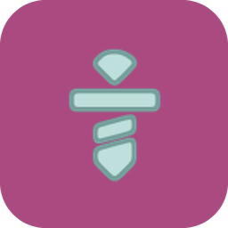
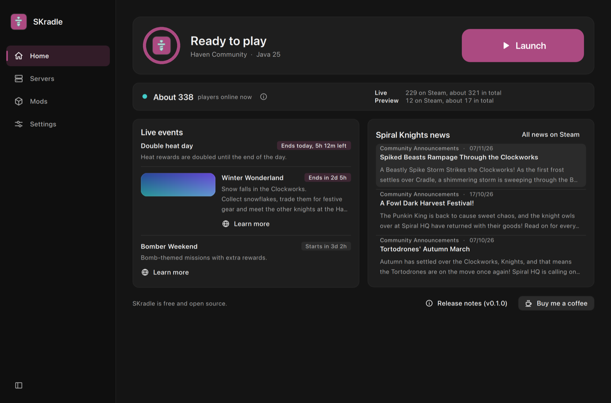
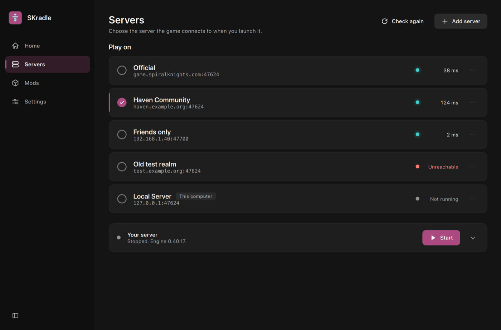
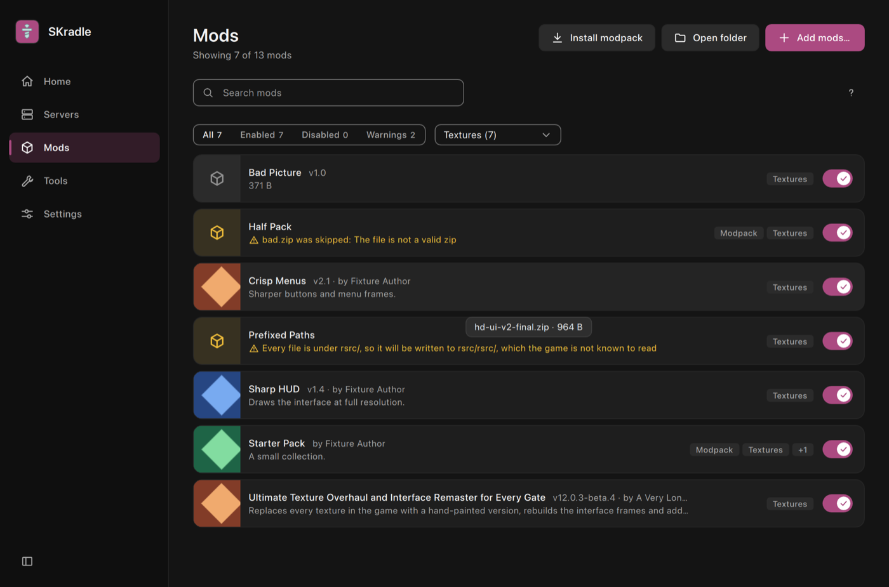
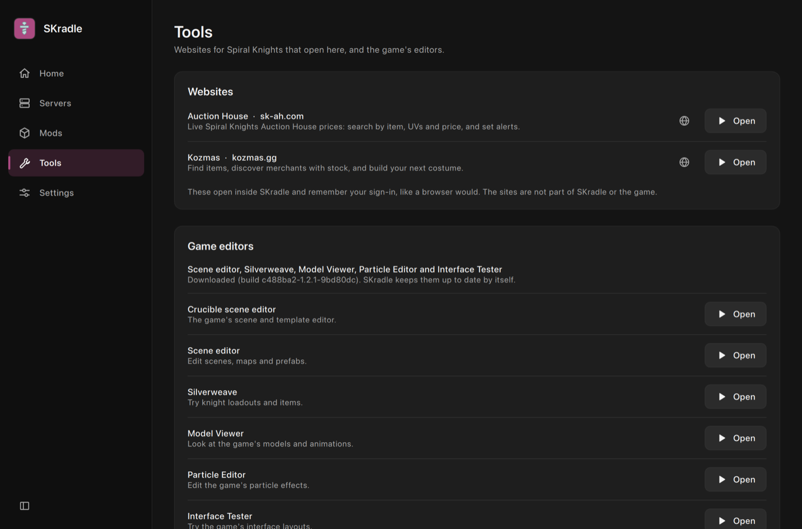
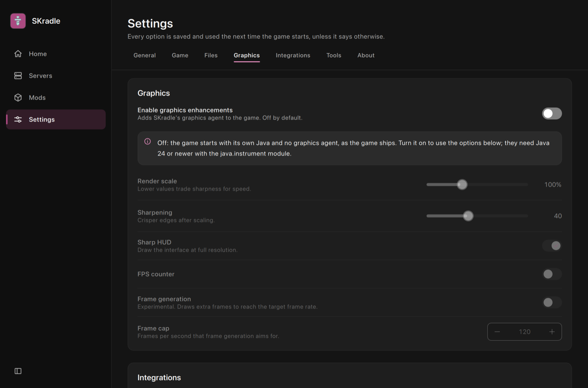

<p align="center">
  
</p>

<h1 align="center">SKradle</h1>

<p align="center">
  A fast, good-looking desktop launcher for <a href="https://www.spiralknights.com/">Spiral Knights</a>
  on Windows, macOS and Linux.
</p>

<p align="center">
  <a href="https://github.com/SKonstruct/SKradle/actions/workflows/ci.yml"></a>
  <a href="LICENSE"></a>
  
</p>

<p align="center">
  
</p>

> **Status:** work in progress. Nothing is released yet (see the [changelog](CHANGELOG.md)); test builds come from CI.
> Screenshots show sample data.

SKradle finds your Steam or standalone copy of the game, applies your mods, picks the server and starts it, on a
Java that suits the game. It can also host a private server on your own computer. The interface is a single native
Qt Quick application with one look on every system, light and dark themes, and keyboard and screen-reader support.

## Highlights

| | |
| --- | --- |
| **Launch** | Finds Steam and standalone installs (or add a folder), signs in through Steam for you, starts the game directly on a suitable Java, and keeps a second client (alt mode) lightweight. |
| **Servers** | Live status and ping for every server, add your own, install, start, stop, back up and update a server on your computer with its web interface and console inside the window. |
| **Mods** | Drag and drop, on/off switches, pictures, tags, filters and search, conflict detection between mods, automatic best-order sorting, and one-click install and update of the maintained modpack. |
| **Tools** | The game's editors (Crucible, scene editor, Silverweave, Model Viewer, Particle Editor, Interface Tester, datdec), always the newest builds, plus Spiral Knights websites that open inside the launcher and keep your sign-in. |
| **Home** | Live events with countdowns, the latest news, and the number of players online with charts of the last 24 hours, 7 days and 30 days. |
| **Settings** | Memory, garbage collector and Java, file cleaning and reset, optional graphics enhancements, Discord Rich Presence, themes, reduced motion, language, and automatic updates of SKradle itself. |

<table>
  <tr>
    <td></td>
    <td></td>
  </tr>
  <tr>
    <td></td>
    <td></td>
  </tr>
</table>

## Download

Test builds come from the **CI** workflow: open a run on the [Actions](../../actions/workflows/ci.yml) tab (any push to
`main`, or *Run workflow*) and download the package for your system under *Artifacts*. Each download is a zip holding the
installer and a `SHA256SUMS.txt`. A version tag (`v*`) publishes the same installers as a GitHub Release, which is what
SKradle's own update reads.

| System | Installer | Notes |
| --- | --- | --- |
| Windows 10 and 11 (x64, ARM64) | `SKradle-<version>-windows-<arch>-installer.exe` | Per user, no administrator rights. Shows the licence, follows Windows' light or dark mode, can add a desktop shortcut. |
| macOS 13 or newer (Apple silicon, Intel) | `SKradle-<version>-macos-<arch>.dmg` | Open it and drag SKradle onto the Applications shortcut. |
| Linux (x64) | `SKradle-<version>-linux-x64.AppImage` | `chmod +x` and run; the launcher's own update replaces it. Needs `libfuse2` on newer Ubuntu releases. |
| Linux (x64) | `SKradle-<version>-linux-x64.deb`, `.rpm` | For Debian, Ubuntu, Fedora and openSUSE: `sudo apt install ./SKradle-*.deb` or `sudo dnf install ./SKradle-*.rpm`. Installed under `/opt/SKradle`; a new version is installed the same way. |

The builds are **not code-signed yet**, so the first start needs one extra step: on Windows, SmartScreen shows
*More info* > *Run anyway*; on macOS run `xattr -cr /Applications/SKradle.app` once (or right-click > *Open*). Check a
download with `sha256sum -c SHA256SUMS.txt` (`shasum -a 256 -c` on macOS).

**Updates.** SKradle looks for a newer release a moment after it starts, downloads it in the background and installs it
when you choose: the Windows installer runs with a small progress window and starts SKradle again, an AppImage replaces
itself, and the macOS disk image opens for you to drag the app over the old one. Every download is checked against its
published SHA-256 before it is used.

## Languages

English, with catalogues for Arabic, German, Spanish, Estonian, French, Italian, Japanese, Polish, Brazilian Portuguese,
Russian and Simplified and Traditional Chinese (the same set as Knight Launcher), including right-to-left layout for
Arabic. Untranslated text shows in English, so a language can ship while it is still being filled in. See
[translating](docs/translating.md) to help.

## Build from source

The launcher logic is in [`core/`](core) (no Qt; `cargo test` builds and tests it). The Qt Quick application is in
[`app/`](app/README.md): `cargo build -p skradle-app --release` needs **Qt 6.8 or newer** and **Rust 1.85 or newer**; the
app README has the setup, command-line flags (`--selftest`, `--shots`, `--pseudo`, ...) and debugging notes.

```sh
cargo test                                   # the core
cargo test -p skradle-app                    # the app (needs Qt, see app/README.md)
cargo run  -p skradle-app --release
```

CI builds, tests and lints on Windows, macOS and Linux, then packages the installers
(see [`.github/workflows/ci.yml`](.github/workflows/ci.yml) and [`packaging/`](packaging)).

## Documentation

| Topic | |
| --- | --- |
| [Launching](docs/launching.md) | How the game is started: Java, Steam sign-in, alt mode, the launch planner, updates. |
| [Mods](docs/mods.md) | Formats, applying and removing, file cleaning, automatic order, the modpack, safety limits. |
| [Hosting a server](docs/server-host.md) | The private server SKradle manages, backups and connecting the game. |
| [Editors](docs/editors.md) · [Websites](docs/web-tools.md) | The Tools page. |
| [Live events](docs/live-events.md) | The events feed and why it is the only plain-HTTP request. |
| [Translating](docs/translating.md) | Catalogues, the workflow and a model prompt. |
| [Logging](docs/logging.md) · [Crash reports](docs/crash-reports.md) | What is logged, scrubbed and sent, and how to turn it off. |
| [Design system](docs/design-system.md) | Tokens, components and the rules the interface follows. |

## Support

Something wrong? [Open an issue](../../issues/new/choose); the form asks for the log (*Settings > About > Open log
folder*). Logs are scrubbed of personal paths and names before you share them.

## Credits

Built with love by [SirDank](https://dankware.alwaysdata.net/). SKradle stands on the work of others:

- [Knight Launcher](https://github.com/lucasluqui/KnightLauncher) by lucasluqui, whose feature set and events feed
  inspired it.
- [Clyde](https://github.com/threerings/clyde) by Three Rings, [spiralview](https://github.com/lucasluqui/spiralview)
  and [datdec](https://github.com/lucasluqui/datdec) by lucasluqui: the editors on the Tools page.
- [Tortodrone](https://github.com/N0rule/Tortodrone): the private server engine SKradle manages.
- [SirDank's Modpack](https://github.com/SirDank): the maintained modpack.
- [Qt](https://www.qt.io/), [cxx-qt](https://github.com/KDAB/cxx-qt) and the Rust crates listed in `Cargo.lock`.

> Unofficial fan project. Not affiliated with Grey Havens. Spiral Knights (c) Grey Havens, LLC.

## License

[MIT](LICENSE)
